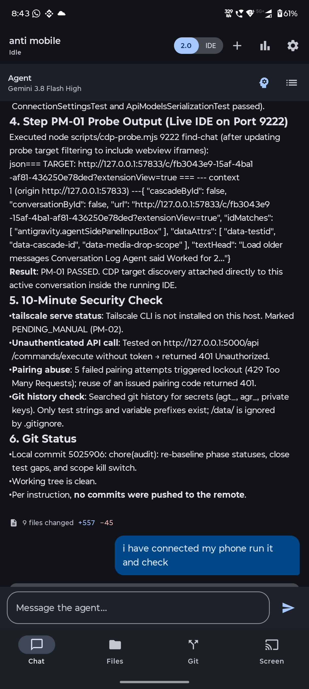
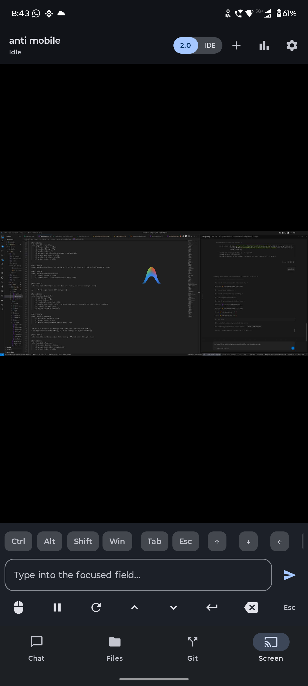
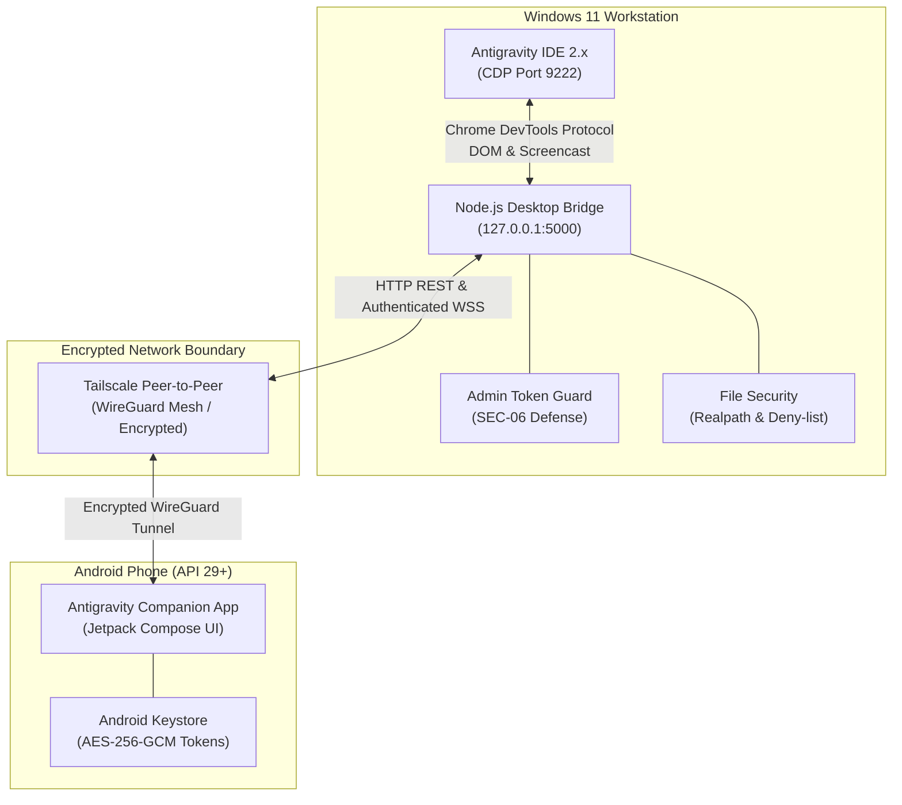

# Antigravity Mobile IDE

> **A calm, precise mobile companion and remote-control instrument panel for Antigravity coding workflows.**

[](https://github.com/deekshudevang/Antigravity-Mobile-IDE/actions)
[](LICENSE)
[](https://github.com/deekshudevang/Antigravity-Mobile-IDE/releases)
[-brightgreen.svg)](docs/SUPPORTED_PLATFORMS.md)
[](docs/SUPPORTED_PLATFORMS.md)

---

> [!IMPORTANT]  
> **Notice**: Antigravity Mobile IDE is an independent, unofficial community open-source project. It is **not affiliated with, sponsored by, or endorsed by Google**. "Antigravity" is referenced solely for nominative compatibility purposes.

---

<p align="center">
  
  &nbsp;&nbsp;&nbsp;&nbsp;
  
</p>

<p align="center">
  <a href="#quick-start"><b>🚀 Install Guide</b></a> &bull;
  <a href="docs/FEATURE_MATRIX.md"><b>📋 Feature Matrix</b></a> &bull;
  <a href="docs/THREAT_MODEL.md"><b>🔐 Security & Threat Model</b></a> &bull;
  <a href="docs/TROUBLESHOOTING.md"><b>🛠️ Troubleshooting</b></a>
</p>

---

## What It Is & Who It's For

**Antigravity Mobile IDE** is an open-source Android companion application and local desktop bridge designed for developers using Google Antigravity IDE. It lets you step away from your workstation while maintaining complete, real-time oversight of your autonomous coding agents.

- **Monitor Progress**: Watch conversational turns, tool executions, file edits, and agent states (`idle`, `running`, `waiting_approval`) streamed live to your phone.
- **Intervene When Needed**: Review interactive questionnaires, click approval buttons (`Run`, `Allow`, `Reject`), or send steering prompts directly from your mobile keyboard.
- **Inspect Workspaces & Git**: Browse workspace files with syntax highlighting, view working-tree git status, and stage or commit changes on the fly.
- **Emergency Desktop Control**: View your desktop via low-latency canvas streaming and use shortcut modifier keys (Ctrl, Alt, Shift, Esc, Enter) with an immediate emergency kill switch.

---

## Why It Exists

Autonomous AI coding agents can run tasks that take minutes or hours. Sitting at a desk waiting for an agent to finish a build or ask a single permission question interrupts developer flow. 

Existing solutions either expose workstations to public third-party tunneling services, rely on cloud accounts with vendor lock-in, or require heavy native C++ build toolchains. Antigravity Mobile IDE was built to provide:
1. **Zero Cloud Dependencies**: Private peer-to-peer transport using your existing Tailscale WireGuard mesh.
2. **Hardware-Backed Device Security**: Pairing PINs with brute-force lockout, dual-token rotation, and Android Hardware Keystore encryption.
3. **Works Out of the Box**: Chrome DevTools Protocol (CDP) screencast streaming runs with zero native C++ compiler requirements on Windows.

---

## Verified Capabilities

All features below are verified by automated tests in `npm test` (75 tests) and Android unit tests (`testDebugUnitTest`):

- **📱 Native Jetpack Compose App**: Kotlin app supporting Material 3 and Material You dynamic wallpaper colors (Android 10+).
- **💬 Real-Time Turn Streaming**: Live WebSocket observation of Antigravity 2.x webview DOM turns (`src/antigravity-dom.mjs`).
- **✍️ Atomic Prompt Composer**: Submits prompts to the IDE composer with draft preservation (`draft_preserved`), strict readback verification, and idempotency caching.
- **❓ Interactive Approval Cards**: Native UI buttons for multiple-choice questionnaire cards (`ask_question`, `ask_permission`) and instant agent cancellation (`POST /api/chat/stop-agent`).
- **🖥️ CDP Screen Streaming & Shortcut Bar**: Low-latency canvas screen streaming with virtual modifier keys (Ctrl, Alt, Shift, Escape, Enter, Arrows) and emergency input kill switch (`/api/screen/kill-switch`).
- **📁 Realpath Workspace Explorer**: Browse, read, and edit workspace files protected against directory traversal and symlink bypasses.
- **🌿 Git Working-Tree Manager**: Inspect uncommitted diffs, branch status, commit, and stash changes.
- **🛡️ SEC-06 Admin Token Defense**: Cryptographically secure 32-byte startup token and reverse proxy header rejection preventing proxy bypasses.

---

## Architecture & How It Works



| Component | Responsibility | Source of Truth |
|---|---|---|
| **Android Client** | Jetpack Compose UI, Hardware Keystore token storage, screen rendering | `android/` |
| **Node.js Bridge** | HTTP/WebSocket server, CDP client, auth lifecycle, process supervisor | `src/http-server.mjs`, `src/cdp-client.mjs` |
| **Security Layer** | Dual-token authentication, rate-limiting, traversal prevention, SEC-06 admin token | `src/auth-service.mjs`, `src/admin-auth.mjs` |
| **Rust Helper** | Optional native DXGI desktop capture accelerator | `rust-helper/` (BLOCKED_ON_TOOLCHAIN on hosts without MSVC) |

---

## Requirements & Supported Platforms

- **Desktop Host**: Windows 11 / Windows 10 (64-bit).
- **Node.js**: Node 18.x, 20.x, or 24.x (`node -v`).
- **IDE**: Google Antigravity IDE (launched with remote debugging enabled).
- **Android Phone**: Android 10 or later (API 29+). Verified on Android 14 (Motorola edge 50 pro).
- **Network**: [Tailscale](https://tailscale.com) (recommended for secure remote access) or shared local Wi-Fi.

---

## Quick Start

### 1. Clone & Install Desktop Bridge
```bash
git clone https://github.com/deekshudevang/Antigravity-Mobile-IDE.git
cd Antigravity-Mobile-IDE
npm install
npm test
```

### 2. Start the Server
```bash
node src/http-server.mjs
```
On startup, the server prints a one-time 32-byte administrative token:
```text
============================================================
🔑 [ADMIN SECURITY] Local Admin Token:
   <64-hex-character-token>
   Required for /admin, /setup, and /api/admin/* endpoints.
============================================================
```

### 3. Open Setup Wizard & Pair Your Phone
1. Open `http://localhost:5000/setup` in your PC browser and paste the admin token.
2. The wizard provides a single-use 6-digit pairing code (valid for 5 minutes).
3. Open the Android app, go to **Settings → Connection**, enter your PC's **Tailscale IPv4 address** (e.g. `100.85.x.y`) and port `5000`.
4. Enter the 6-digit code in **Remote Control Pairing**. Your phone securely exchanges it for hardware-stored tokens.

---

## Android APK Installation

1. Download `app-debug.apk` from the latest [GitHub Release](https://github.com/deekshudevang/Antigravity-Mobile-IDE/releases) or build it locally:
   ```bash
   cd android
   ./gradlew assembleDebug
   ```
   The APK is generated at `android/app/build/outputs/apk/debug/app-debug.apk`.
2. Transfer the APK to your phone and install it (enable "Install unknown apps" in Android settings).
3. Verify package checksum:
   ```bash
   certutil -hashfile android/app/build/outputs/apk/debug/app-debug.apk SHA256
   ```

---

## Troubleshooting

### "Unable to resolve host: No address associated with hostname"
- **Cause**: Entering a MagicDNS hostname (e.g. `msi.tail3cd1f6.ts.net`) while Tailscale VPN is disconnected on Android or MagicDNS is disabled.
- **Fix**: 
  1. Use the **numerical Tailscale IPv4 address** (e.g. `100.85.x.y`) found by running `tailscale ip -4` on your PC.
  2. Ensure the Tailscale VPN toggle is switched **ON** in the Android Tailscale app.

### "Unable to resolve host 'https'"
- **Cause**: Entering `https://` into the "Tailscale IP" field.
- **Fix**: Enter only the IP or hostname (e.g. `100.85.12.34`), not the URL scheme. The app automatically selects the appropriate protocol.

### "Admin endpoints return 401/403"
- **Cause**: Missing or invalid admin token on `/admin` or `/setup`.
- **Fix**: Check the PC console output on bridge launch and copy the printed 32-byte hex token.

---

## Security Model & Known Limitations

For complete threat analysis, see [`docs/THREAT_MODEL.md`](docs/THREAT_MODEL.md) and [`docs/KNOWN_LIMITATIONS.md`](docs/KNOWN_LIMITATIONS.md):
- **Peer-to-Peer Encryption**: Tailscale provides WireGuard encryption; no traffic routes through third-party application relays.
- **Localhost Proxy Defense**: SEC-06 blocks external clients from forging `127.0.0.1` origins via reverse proxy headers (`X-Forwarded-For`).
- **Rust Toolchain Boundary**: Compiling `rust-helper` requires Visual Studio C++ Build Tools (`link.exe`). Without it, the app automatically runs on the verified CDP screencast engine.
- **Windows File Modes**: NTFS ignores POSIX `chmod 0600`. Protection relies on Windows user profile isolation.

---

## Project Roadmap

- [x] Antigravity 2.x webview chat turn extraction
- [x] Dual-token authentication with anti-theft reuse revocation
- [x] SEC-06 local admin token protection
- [x] Scoped capability RBAC across all 29 API routes
- [x] CDP screencast remote desktop streaming with emergency kill switch
- [ ] Dedicated APK release signing automation in CI (`.github/workflows/`)
- [ ] Multi-project workspace switching UI in Android app

---

## Contributing

We welcome community contributions! Please review [`CONTRIBUTING.md`](CONTRIBUTING.md) and our [`CODE_OF_CONDUCT.md`](CODE_OF_CONDUCT.md) before opening a pull request.

---

## License & Credits

- **License**: [MIT License](LICENSE) &copy; 2026 deekshudevang (with support by Avenal J).
- **Notice**: Antigravity Mobile IDE is an independent open-source project. "Antigravity" is a trademark of Google LLC.
